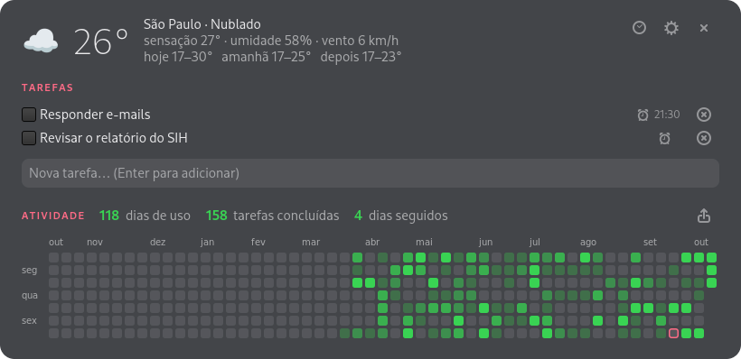
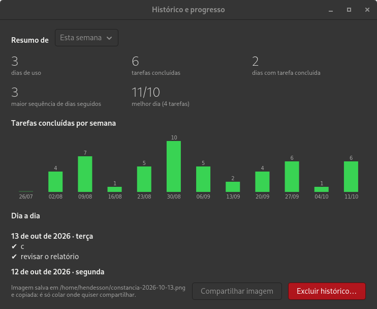
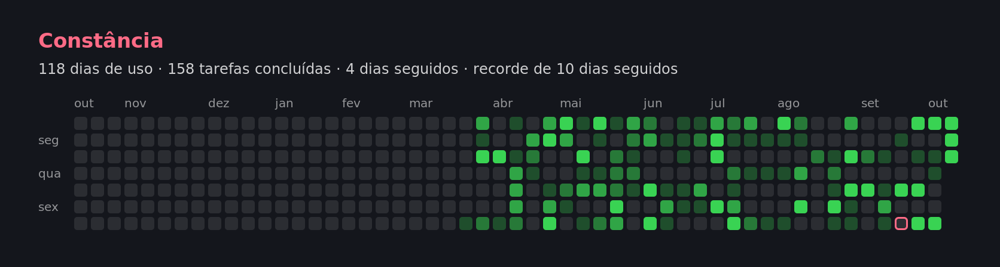

# constancia

Um painel para a área de trabalho que abre sozinho quando você liga o
computador e mostra o **clima**, as suas **tarefas** e um **gráfico de
atividade** no estilo do "contribution graph" do GitHub — só que quem preenche
os quadradinhos é o seu dia a dia: **usar o computador conta, e cada tarefa
concluída conta mais**.



- Marque a caixa de uma tarefa para concluí-la: ela some da lista e o dia de
  hoje fica mais verde.
- Digite no campo e aperte Enter para adicionar uma tarefa.
- O ícone de despertador ao lado da tarefa põe um **alarme** nela.
- Passe o mouse sobre um quadradinho para ver o que aconteceu naquele dia.
- Arraste o painel por qualquer ponto para movê-lo.
- O relógio no canto abre o **histórico**; a engrenagem abre as
  **configurações**.

## Como os pontos funcionam

| Pontos no dia | O que significa                        | Cor         |
|---------------|----------------------------------------|-------------|
| 0             | não usou o computador                  | cinza       |
| 1             | usou o computador                      | verde fraco |
| 2             | usou e concluiu 1 tarefa               | ↓           |
| 3 a 4         | usou e concluiu 2 ou 3 tarefas         | ↓           |
| 5 ou mais     | usou e concluiu 4 tarefas ou mais      | verde vivo  |

- **Dia de uso**: um timer do systemd verifica a cada 10 minutos se a tela está
  desbloqueada e, se estiver, marca o dia. O painel aberto faz o mesmo.
- **Tarefa concluída**: cada tarefa marcada soma um ponto no dia de hoje.

## Histórico, resumo e progresso



- **Resumo** de hoje, desta semana, deste mês, deste ano ou desde o início:
  dias de uso, tarefas concluídas, maior sequência e melhor dia.
- **Tarefas concluídas por semana** nas últimas 12 semanas.
- **Dia a dia**: tudo o que você concluiu no período escolhido.
- **Compartilhar imagem**: salva um PNG com o resumo e o gráfico na pasta de
  imagens e copia para a área de transferência, pronto para colar. No painel,
  o botão de enviar ao lado do gráfico faz o mesmo, com a opção de
  compartilhar **só o gráfico**.
- **Excluir histórico**: apaga dias de uso e tarefas concluídas (pede
  confirmação; as tarefas pendentes e o desenho ficam).



## Alarmes e notificações

- **Alarme por tarefa**: clique no despertador da tarefa e digite `14:30` (hoje, ou amanhã se já
  passou) ou `25/12 09:00`. Na hora, aparece uma notificação e toca um som.
- **Lembrete diário**: numa hora escolhida, avisa quantas tarefas estão
  pendentes e se hoje é dia do desenho.

Notificações, som e lembrete são ligados e desligados nas configurações. Os
alarmes disparam enquanto o painel está aberto; se ele estava fechado na hora,
disparam quando for aberto.

## Personalização

Nas configurações (as mudanças valem na hora):

- cor de fundo e opacidade do painel (o texto fica claro ou escuro sozinho);
- cor dos títulos e cor do gráfico;
- dias em quadrados ou círculos;
- mostrar ou esconder o clima, e a cidade do clima.

### Desenho no gráfico

Em *Configurações → Editar desenho* você marca, clicando ou arrastando, os dias
que formam um desenho (um coração, uma palavra, uma onda…). No gráfico, cada
dia marcado aparece com contorno e fica na cor cheia quando você usa o
computador ou conclui tarefas nele — o desenho vai se formando com o tempo.

## Sincronizar entre computadores (opcional)

O programa funciona inteiro sem conta nenhuma. Se quiser os mesmos dados em
mais de um computador, ele usa um repositório git seu — por exemplo, um
repositório **privado** no GitHub:

1. Crie um repositório privado e vazio (ex.: `constancia-dados`) em
   <https://github.com/new>.
2. Em cada computador, abra *Configurações → Sincronização*, cole o endereço
   (ex.: `git@github.com:seu-usuario/constancia-dados.git`) e clique em
   **Sincronizar agora**.

O computador precisa já conseguir usar esse repositório pelo `git` (chave SSH
ou credencial salva). Depois disso a sincronização é automática: ao abrir, a
cada 10 minutos e alguns segundos depois de cada mudança. Tarefas, histórico,
alarmes e desenho são unidos sem conflito; cores e demais configurações ficam
por computador. Use um repositório privado: as suas tarefas ficam nele em texto
simples.

## Painel preso à área de trabalho (GNOME)

No GNOME, o instalador também instala uma pequena extensão que deixa o painel
atrás das outras janelas, visível em todas as áreas de trabalho, e lembra onde
você o colocou (na primeira vez ele vai para o canto superior direito). Ela
passa a valer depois de sair da sessão e entrar de novo. Para desligar:

```sh
gnome-extensions disable constancia@hendesson.github.io
```

Funciona no GNOME 46 a 48. Em outros ambientes o painel é uma janela comum.

## Instalação

Precisa de Linux com Python 3.8+ e GTK 4.10+ para Python (já vêm no GNOME; em
Debian/Ubuntu: `sudo apt install python3-gi gir1.2-gtk-4.0`). O registro
automático dos dias de uso usa o systemd; a sincronização usa o `git`.

```sh
git clone https://github.com/Hendesson/constancia.git
cd constancia
./install.sh
```

Não precisa de `sudo`. O instalador coloca o programa em `~/.local/bin`, ativa
o timer, cria o atalho "Constância" no menu de aplicativos e configura o painel
para abrir ao entrar na sessão (apague
`~/.config/autostart/io.github.hendesson.constancia.desktop` se não quiser o
início automático).

## Clima

A temperatura vem do [wttr.in](https://wttr.in), que detecta a cidade pelo seu
IP; a cidade pode ser fixada nas configurações. O clima é atualizado a cada 30
minutos. Fora o clima e a sincronização (se você ligar), nada sai da sua
máquina.

## Também pelo terminal

```
constancia painel              abre o painel
constancia                     mostra as tarefas e o gráfico no terminal
constancia add TEXTO           adiciona uma tarefa
constancia ok N [N...]         conclui tarefas (contam no gráfico)
constancia rm N [N...]         remove tarefas sem contar
constancia alarme N HORA       põe um alarme na tarefa N
constancia resumo [PERÍODO]    resumo de: dia, semana, mes, ano ou tudo
constancia compartilhar [ARQ]  salva a imagem para compartilhar
constancia sync                sincroniza agora
constancia clima               mostra o clima
```

O painel se atualiza sozinho quando você muda algo pelo terminal.

## Onde ficam os dados

Arquivos de texto simples em `~/.local/share/constancia/` (ou em
`$XDG_DATA_HOME/constancia/`), fáceis de ler ou fazer backup:

| Arquivo          | Conteúdo                                              |
|------------------|-------------------------------------------------------|
| `tarefas.tsv`    | tarefas pendentes: `id<TAB>texto<TAB>alarme`          |
| `uso.txt`        | dias de uso, um por linha (`AAAA-MM-DD`)              |
| `concluidas.tsv` | tarefas concluídas: `dia<TAB>texto<TAB>id<TAB>momento` |
| `desenho.txt`    | dias marcados no desenho                              |
| `removidas.txt`, `limpeza.txt` | controle usado pela sincronização       |

As configurações ficam em `~/.config/constancia/config.json`.

## Limitações

- Fora do GNOME (ou sem a extensão) o painel é uma janela comum: no Wayland um
  programa não pode escolher a própria posição nem se fixar no fundo.
- Com a extensão, o painel ainda aparece na visão geral e no Alt+Tab.
- A sincronização exige `git` configurado; não há login por e-mail e senha.
- A detecção de tela bloqueada usa o `LockedHint` do systemd-logind, que GNOME
  e KDE atualizam. Em ambientes que não o atualizam, todo dia com a sessão
  aberta conta como dia de uso.

## Desinstalar

```sh
./uninstall.sh
```

Seus dados são mantidos.

## Licença

MIT — veja [LICENSE](LICENSE).
